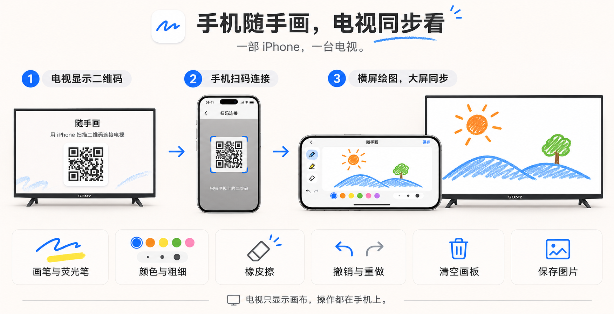
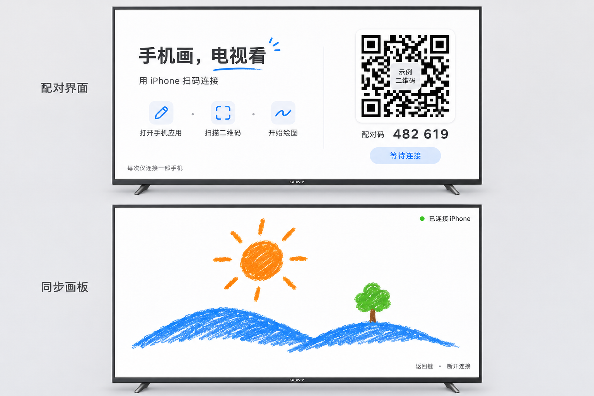

English | [简体中文](README.md)

> Note: the rest of the documentation in this repo (e.g. [docs/protocol.md](docs/protocol.md)) is written in Chinese.

<p align="center">
  
</p>

<h1 align="center">Suishouhua (随手画 — finger drawing, synced to TV)</h1>

<p align="center"><strong>Draw on your phone, watch it live on the TV.</strong></p>

<p align="center">
  <a href="#features">Features</a> ·
  <a href="#build--run">Build &amp; Run</a> ·
  <a href="#docsprotocormd">Sync Protocol</a> ·
  <a href="https://github.com/yangyao/suishouhua/issues">Report Issues</a>
</p>

Draw with your finger on an iPhone (or any mobile browser), and your strokes appear in real time on the big TV screen in your living room. The TV only displays the canvas — everything is controlled from the phone. Turn on the TV, scan a QR code, and start drawing.

**Native iPhone &amp; Android TV clients · Scan-to-connect · No sign-up · No backend**



*Scan the QR code on the TV with your phone, draw in landscape, strokes sync to the big screen in real time.*

## Features

- **Scan to connect**: the TV shows a QR code; the iPhone scans it (or any phone opens the URL) and lands straight on the canvas — zero install, zero sign-up
- **Real-time sync**: direct LAN connection, strokes appear on screen as you draw, writing latency ≤ 100ms
- **Full toolset**: pen / highlighter, 5 colors × 3 stroke widths, eraser (per stroke), undo / redo, clear canvas
- **Save artwork**: one-tap export to the photo library on iPhone; the web client downloads a PNG
- **Data stays home**: the TV hosts the service and the phone connects directly — no cloud, no accounts



*TV side: pairing screen and synced canvas.*

## Architecture

```
iPhone / mobile browser          Android TV / Sony TV
  canvas + tools + touch    ──►   embedded Ktor service (port 9723)
  WebSocket client          ◄──   QR code display + full-screen canvas rendering
```

No backend, no cloud: the TV app embeds a lightweight HTTP/WebSocket service, and after scanning the QR code the phone connects directly over the LAN (single hop). The authoritative definition of the sync protocol lives in [docs/protocol.md](docs/protocol.md) (in Chinese): JSON messages (stroke start / incremental points / undo / redo / clear), 0–1 normalized coordinates, and a 16:9 canvas mapped independently on each side.

## Build & Run

### TV side (Kotlin, compileSdk 34 / minSdk 26)

```bash
cd tv && ./gradlew installDebug   # Android Studio works too
adb connect <tv-ip>:5555          # deploy to a real device
```

Once started, the TV enters the pairing page and shows the QR code.

### iPhone side (SwiftUI, iOS 16+)

The Xcode project is generated with [XcodeGen](https://github.com/yonaskolb/XcodeGen):

```bash
cd ios && xcodegen generate        # generates SuishouHua.xcodeproj
open SuishouHua.xcodeproj          # pick a real device (camera needed for scanning) or a simulator and run
```

### Web

No build needed — the QR code on the TV is itself the web entry point; open it in any phone or desktop browser and start drawing.

## Troubleshooting

- The phone and the TV must be on the same LAN; if the phone can't connect, check your router's AP isolation
- When debugging with a simulator (the simulator's IP is not reachable from the LAN), use `tools/emulator-relay.py` to set up a relay on the host machine; you can override the QR code host with `adb shell am broadcast -a com.suishouhua.tv.SET_HOST --es host <host-machine-ip>`
- For protocol debugging: filter the TV-side logs for `SyncTrace` to see connection and stroke events

## License

[MIT](LICENSE)
