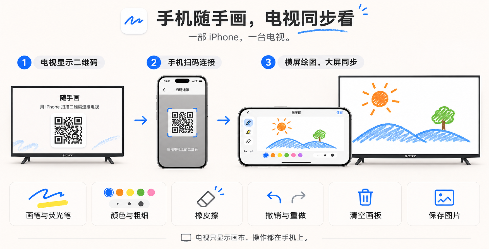
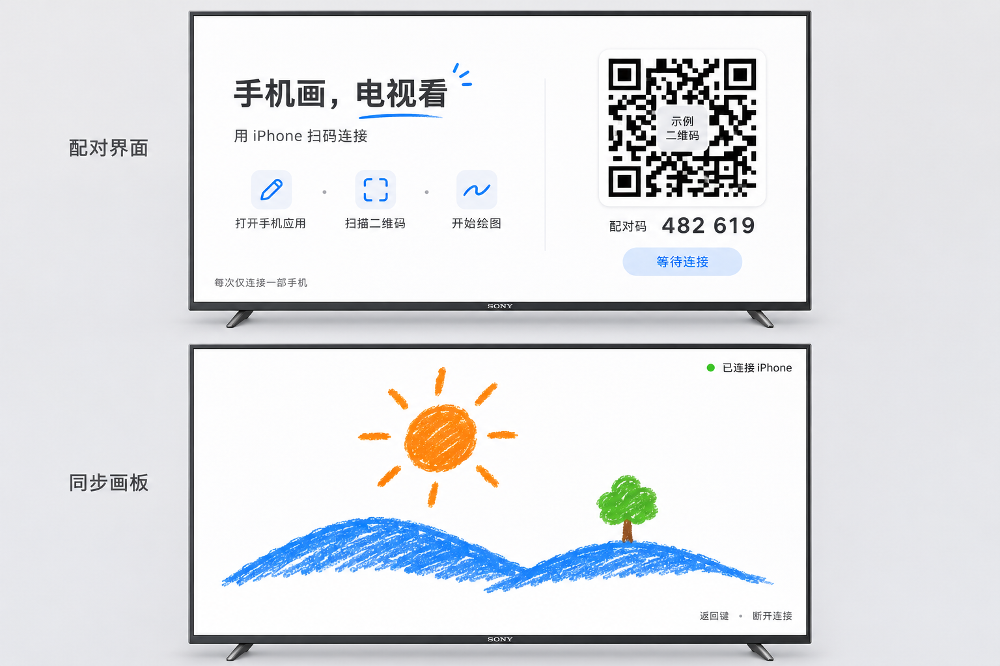

<p align="center">
  
</p>

<h1 align="center">随手画</h1>

<p align="center"><strong>手机随手画，电视同步看。</strong></p>

<p align="center">
  <a href="#功能">功能</a> ·
  <a href="#构建与运行">构建与运行</a> ·
  <a href="#docsprotocormd">同步协议</a> ·
  <a href="https://github.com/yangyao/suishouhua/issues">反馈问题</a>
</p>

用手指在 iPhone 上（或任何手机浏览器里）画画，笔迹实时出现在客厅电视的大屏上。电视只显示画布，所有操作都在手机上。打开电视，扫一个码，就开始画。

**原生 iPhone 与 Android TV 客户端 · 手机扫码直连 · 无需注册 · 无后端**



*手机扫码连接电视，横屏绘图，大屏实时同步。*

## 功能

- **扫码即连**：电视显示二维码，iPhone 扫码（或任意手机浏览器打开）直接进入画板，零安装、零注册
- **实时同步**：局域网直连，落笔即上屏，书写延迟 ≤ 100ms
- **工具齐全**：画笔 / 荧光笔、5 色 3 档粗细、橡皮擦（按笔画）、撤销 / 重做、清空画板
- **保存画作**：iPhone 一键导出到相册，Web 端下载 PNG
- **数据不出家门**：电视内嵌服务，手机直连，没有云端、没有账户



*电视端：配对界面与同步画板。*

## 架构

```
iPhone / 手机浏览器          Android TV / Sony TV
  画布 + 工具 + 触摸     ──►   内嵌 Ktor 服务（端口 9723）
  WebSocket 客户端        ◄──   二维码展示 + 全屏画布渲染
```

无后端、无云端：电视应用内嵌轻量 HTTP/WebSocket 服务，手机扫码后局域网直连（单跳）。同步协议的权威定义见 [docs/protocol.md](docs/protocol.md)：JSON 消息（起笔 / 增量点 / 撤销 / 重做 / 清空）、0–1 归一化坐标、16:9 画布两端各自映射。

## 构建与运行

### TV 端（Kotlin，compileSdk 34 / minSdk 26）

```bash
cd tv && ./gradlew installDebug   # Android Studio 亦可
adb connect <tv-ip>:5555          # 真机部署
```

启动后电视进入配对页，显示二维码。

### iPhone 端（SwiftUI，iOS 16+）

工程由 [XcodeGen](https://github.com/yonaskolb/XcodeGen) 生成：

```bash
cd ios && xcodegen generate        # 生成 SuishouHua.xcodeproj
open SuishouHua.xcodeproj          # 选择真机（扫码需相机）或模拟器运行
```

### Web 端

无需构建——电视上的二维码本身就是网页入口，任何手机或电脑浏览器打开即画。

## 联调提示

- 手机与电视须在同一局域网；手机无法连接时检查路由器 AP 隔离
- 用模拟器联调时（模拟器 IP 不可从局域网到达），用 `tools/emulator-relay.py` 在宿主机搭一层转发，二维码 host 可用 `adb shell am broadcast -a com.suishouhua.tv.SET_HOST --es host <宿主机IP>` 覆盖
- 协议联调排查：电视端日志过滤 `SyncTrace` 可看连接与笔画事件

## License

[MIT](LICENSE)
